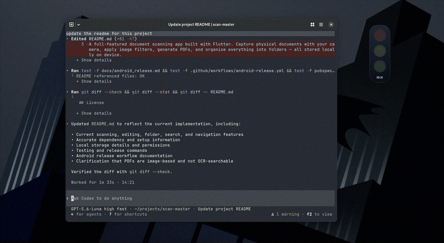

<div align="center">

# 🚦 AgentLight

### See what your coding agents are doing.

**A small desktop traffic light for AI agent activity — virtual or physical, local by design.**



<p>
  
  
  
  
</p>

</div>

AgentLight turns agent lifecycle events into a glanceable light: **yellow** while working, **red** when attention is needed, **green** when a task completes. Give every agent its own floating widget, or connect optional USB hardware.

## What it does

- Tracks sessions across Codex, Claude Code, Cursor, Gemini CLI, Windsurf, GitHub Copilot CLI, and Antigravity.
- Shows a draggable, always-on-top widget for each agent.
- Can mirror status to ESP8266, ESP32, Raspberry Pi Pico, or Arduino hardware.
- Keeps events on your machine and sends status metadata only.

## Get started

Requires Node.js, npm, Rust, and the [Tauri prerequisites](https://tauri.app/start/prerequisites/).

```sh
npm install
npm run tauri dev
```

## Connect an agent

Start AgentLight once, then install the matching hook from the project folder:

```sh
node integrations/codex/install.mjs
```

For Claude Code use `integrations/claude/install.mjs`. For Cursor, Gemini CLI, Windsurf, Copilot CLI, or Antigravity, use `node integrations/agents/install.mjs <agent>`.

## Build and checks

```sh
npm run lint
npm run test:integrations
npm run tauri build
```

Windows MSI and NSIS installers are configured. Other platforms and physical hardware still need hands-on validation.

## Project docs

Start with the [documentation guide](docs/README.md), or jump to the [roadmap](docs/ROADMAP.md), [agent integrations](docs/AGENT_INTEGRATIONS.md), and [hardware guide](docs/HARDWARE_FIRMWARE.md).

<div align="center">

*Local status. Clear signals. Fewer missed moments.*

</div>
